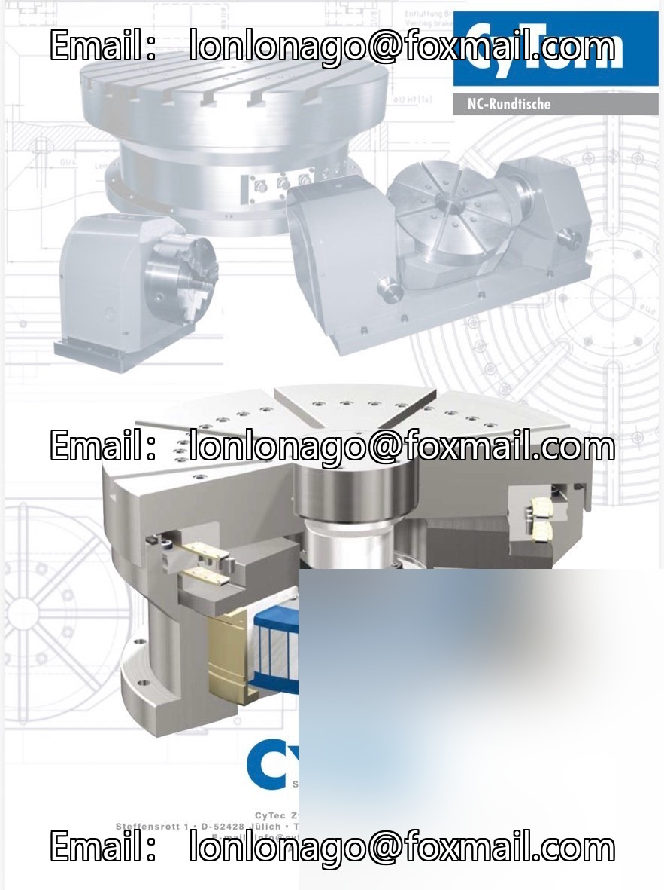
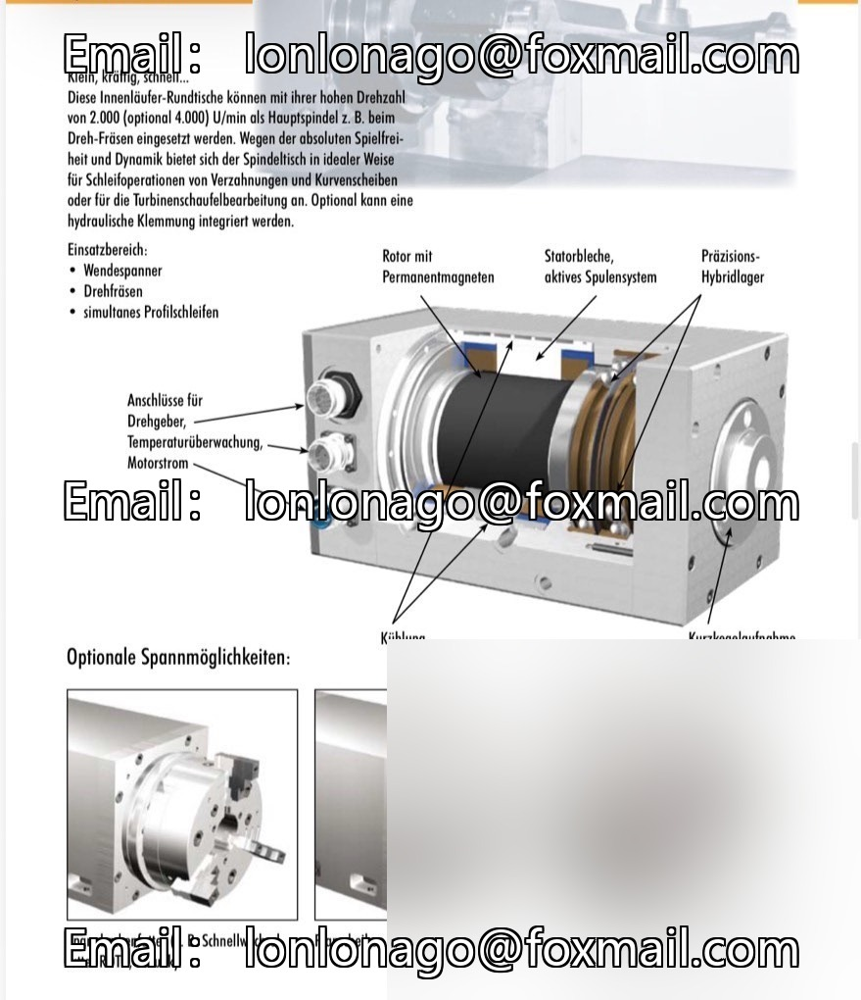
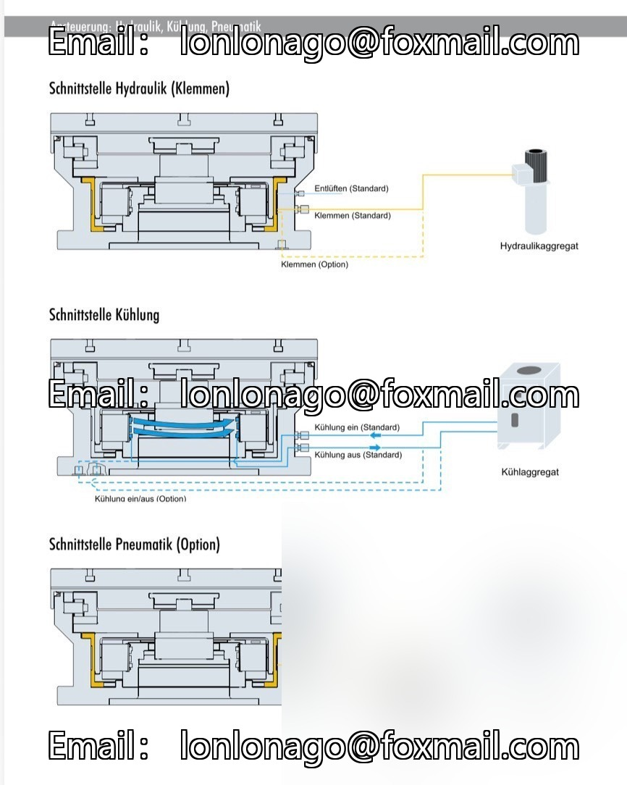

# CyTurn CNC table technology document

## Body

CyTurn CNC spindle documentation: CyTec CyTurn CNC spindle technical materials, including detailed content such as product structure, functional principles, and interface descriptions. PDF file, 40 pages.
Suitable technical reference for five-axis machining centers, CNC machines, automated equipment, and other fields.
upon sale.

The technical document covers the product structure, functional principle and interface instructions of the CyTec CyTurn series CNC turntable, including a PDF of 40 pages; it is suitable for five-axis machining centers, CNC machines and automated equipment, and the sale is non-refundable.

<!-- AI_ENRICHED -->

## Images

## Payment

Here is a pay link on Stripe ( https://buy.stripe.com/3cs8yP7sY87d0vu9AB ). Please contact me lonlonago@foxmail.com after funding $89, and I will send you a complete data files , thank you!

